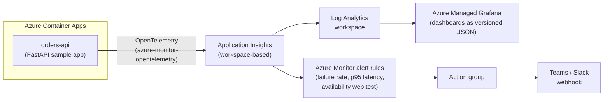

# azure-observability-stack

Drop-in observability for Azure workloads: metrics, logs, traces, dashboards, and alerts, all as code. Includes an instrumented sample app so the whole stack is demonstrable end to end.



## What this demonstrates

- **Day-2 operations thinking.** Provisioning infrastructure is day 1. This repo is about what happens after: knowing the service is healthy, finding out fast when it is not, and having the dashboards already built when the pager goes off.
- **Observability as code.** The workspace, the Application Insights component, every alert rule, the action group, and the Grafana dashboards are all in git. Nothing here was click-built, so nothing here can silently drift or vanish.
- **Real OpenTelemetry instrumentation.** The sample app uses the `azure-monitor-opentelemetry` distro: auto-instrumented request spans, a custom child span (`validate-order`), and a custom business metric (`orders_created`) that flows all the way to a dashboard panel.
- **Symptom-based alert design.** Three alerts, each tied to something a user actually feels: error rate, tail latency, and reachability. Thresholds are justified in comments in `terraform/alerts.tf`, not cargo-culted.
- **Dashboards committed as versioned JSON.** Reviewed in PRs, importable into any deployment of this stack via template variables.

## Repo layout

```
.
|- app/                    FastAPI orders API, Dockerfile, pinned requirements
|- dashboards/             Grafana dashboard JSON + import/provisioning guide
|- scripts/
|  |- generate-traffic.sh  Mixed traffic generator (healthy + errors + latency)
|- terraform/              Single flat root module (see note below)
|  |- main.tf              Resource group, Log Analytics, App Insights
|  |- container_app.tf     Container Apps environment + orders API app
|  |- grafana.tf           Managed Grafana + managed identity role assignments
|  |- alerts.tf            Alert rules, web test, action group (the good part)
|  |- providers.tf / variables.tf / outputs.tf / backend.tf
|- .github/workflows/ci.yml  fmt, validate, tflint, checkov, ruff, py_compile
|- Makefile                deploy / destroy / fmt / validate / lint / build-image / traffic
```

This repo stays a single flat root module on purpose: it is meant to be read top to bottom. At scale the right move is extracting reusable modules (monitoring, app-platform, alerting) with typed inputs, semantic versioning, and a module registry. The [azure-landing-zone](https://github.com/dannyc96/azure-landing-zone) repo in this portfolio shows that pattern.

## Getting started

Prerequisites: Terraform >= 1.9, Azure CLI (logged in), Docker, and `ARM_SUBSCRIPTION_ID` exported.

```bash
# 1. Build and push the sample app image to a registry Container Apps can pull
#    (public ghcr works with zero extra config; for a private ACR, add a
#    registry block with managed identity in terraform/container_app.tf)
make build-image IMAGE=ghcr.io/dannyc96/orders-api:latest
make push-image  IMAGE=ghcr.io/dannyc96/orders-api:latest

# 2. Configure (optional: webhook URL for alert notifications)
cp terraform/terraform.tfvars.example terraform/terraform.tfvars

# 3. Deploy everything
make deploy

# 4. Generate traffic so there is something to look at (5 minutes by default)
make traffic

# 5. Open Grafana and import the dashboard
cd terraform && terraform output -raw grafana_endpoint
```

Then in Grafana: Dashboards -> New -> Import -> paste `dashboards/orders-api-overview.json`, map the Azure Monitor data source, and pick your subscription, resource group, and App Insights component from the dropdowns. Full import and CI-provisioning options are in [dashboards/README.md](dashboards/README.md).

To demo the alerts, push the error rate past the threshold:

```bash
ERROR_WEIGHT=30 ./scripts/generate-traffic.sh "https://$(cd terraform && terraform output -raw app_fqdn)" 600
```

Within two evaluation cycles the failure-rate alert fires and the action group posts to your webhook. Stop the traffic and auto-mitigation resolves it.

## Alert philosophy

Opinionated and short:

- **Alert on symptoms, not causes.** Error rate, tail latency, and availability are what users experience. CPU, memory, and disk are diagnostic data, not alerts; high CPU with healthy latency is not an incident, and there is deliberately no CPU alert in this repo.
- **Every alert must be actionable.** Each rule's description says what to check first. If an alert has no next action, it is noise and it trains people to ignore the channel.
- **Rates, not counts.** The failure alert is a percentage, because a fixed count threshold pages during traffic spikes and sleeps through outages at 2am traffic levels.
- **Percentiles, not averages.** The latency alert watches p95. Averages hide the tail, and the tail is where users live.
- **Thresholds come from SLOs, not from vibes.** Defaults here (5% failure rate, 1000 ms p95, 3 of 5 probe regions down) are documented starting points in `variables.tf` and `alerts.tf`, expected to be tuned against a real SLO.
- **Auto-mitigation on.** Alerts resolve themselves when the signal recovers, so the channel reflects current reality.

## Cost

Rough figures for `eastus2` at demo traffic volume, left running 24/7 (check the Azure pricing calculator for current numbers):

| Component | Approx. monthly |
|-----------|-----------------|
| Azure Managed Grafana (Standard) | ~$50 |
| Availability web test (5 regions, 5 min interval) | ~$30-40 |
| Container App (1 replica, 0.25 vCPU, Consumption) | ~$0-12 after free grant |
| Log Analytics + App Insights ingestion (<1 GB) | ~$3 |
| **Total** | **~$90-105/month, or a few dollars for an afternoon demo** |

Grafana and the multi-region web test dominate. For a cheaper long-running demo, drop the web test to 3 regions and accept the weaker availability signal.

```bash
make destroy   # returns this to $0
```

Everything lives in one resource group, so teardown is complete and verifiable.

## CI

Every push runs `terraform fmt -check`, `terraform validate`, `tflint` (with the azurerm ruleset), and `checkov` on the Terraform, plus `ruff` and a compile check on the app. Checkov skips are documented inline in the workflow with the reason for each.

## Part of a portfolio

This is repo 2 of 3:

1. [azure-landing-zone](https://github.com/dannyc96/azure-landing-zone): subscription-level foundations, modules, policy as code.
2. **azure-observability-stack** (this repo): day-2 operations, telemetry, dashboards, and alerting as code.
3. [azure-openai-rag](https://github.com/dannyc96/azure-openai-rag): an AI workload built on those foundations.

## License

MIT, see [LICENSE](LICENSE).
